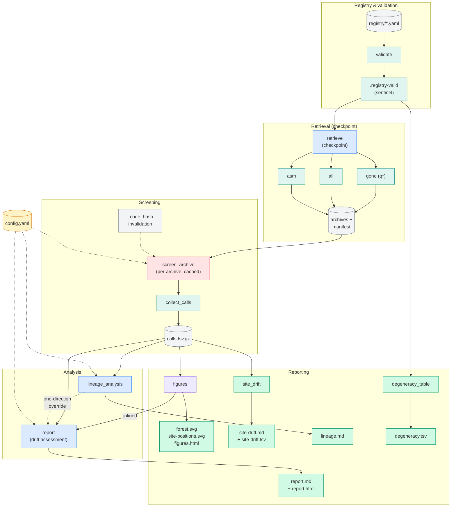
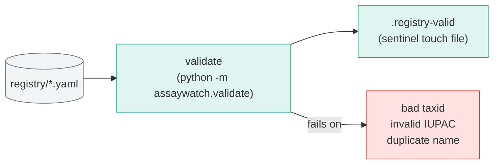
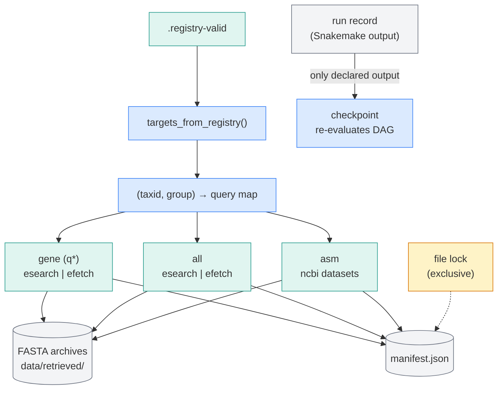
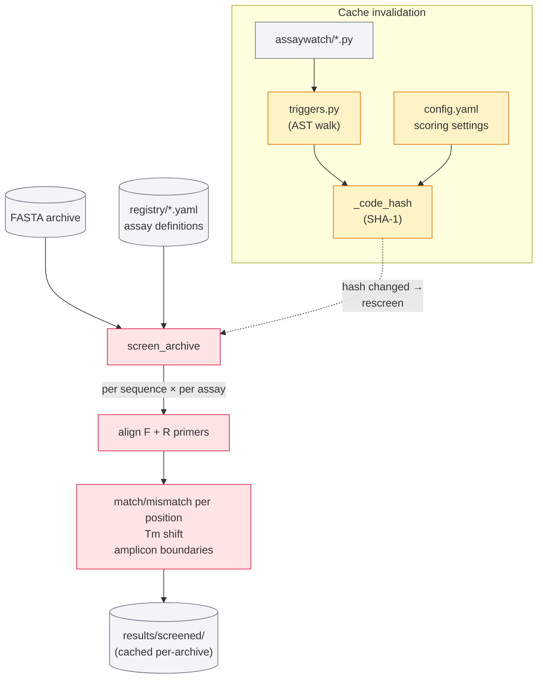
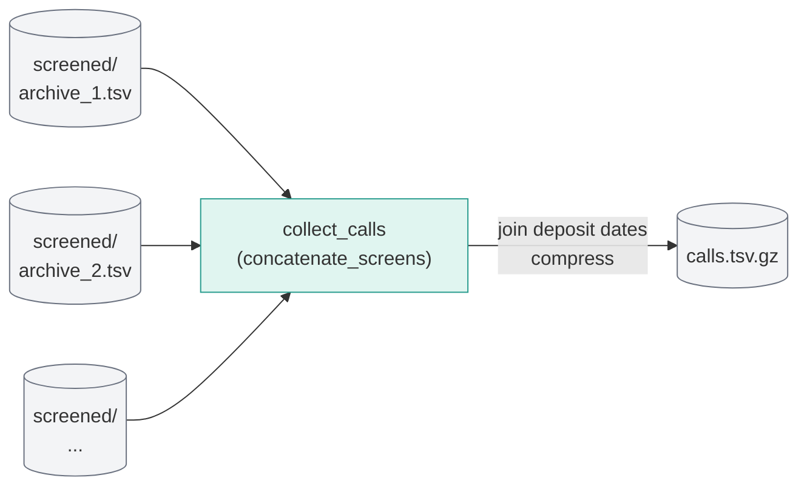
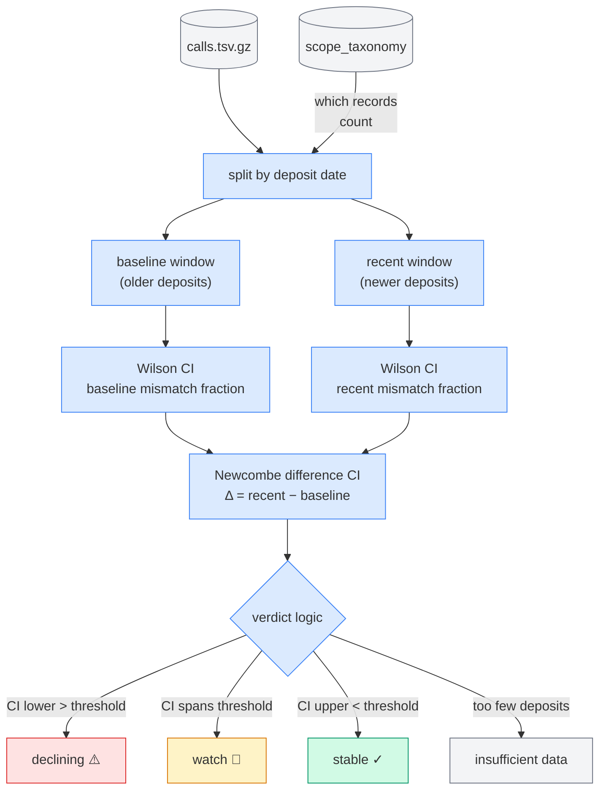
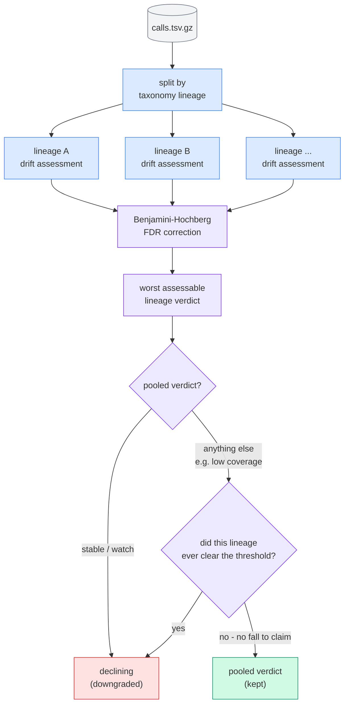
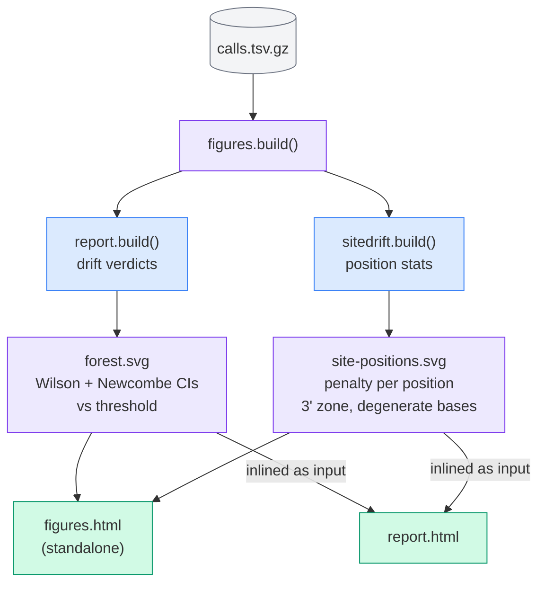
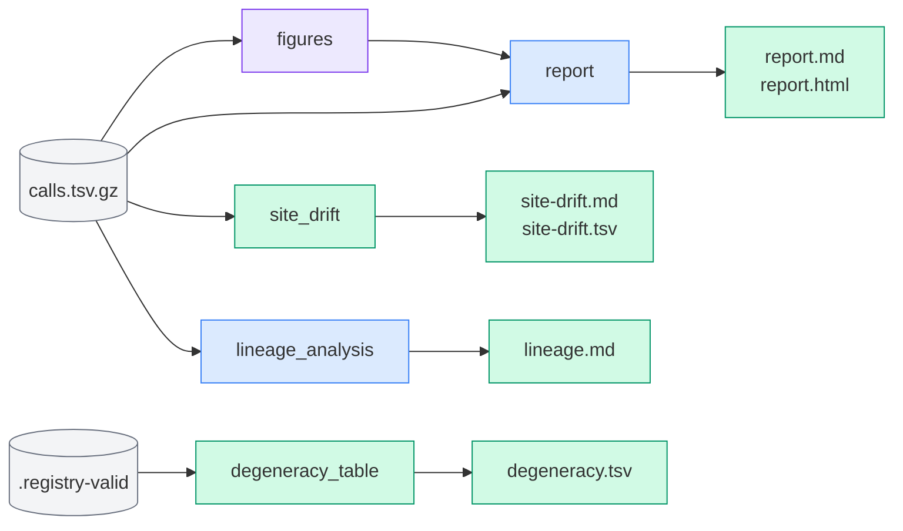

# Pipeline Architecture

Snakemake pipeline for continuous primer-drift surveillance. Each run
re-screens published PCR/qPCR assay primers against newly deposited NCBI
sequences, computes drift statistics, and generates reports.

## Pipeline overview

---

## Step-by-step

### 1. Validate

Each YAML file in `registry/` defines one assay: its taxid, primer sequences,
and probe. The rule checks that taxids resolve in NCBI, primer sequences are
valid IUPAC, and no two assays share a name. Output is a sentinel file (empty
file whose existence means "validation passed") — Snakemake uses its timestamp
to know whether to re-validate.

### 2. Retrieve (checkpoint)

`targets_from_registry()` reads the validated YAML and builds a map of
`(taxid, group)` → query parameters. Three group types fan out to NCBI Entrez:
gene-targeted queries (`q*` groups scoped to specific genes), broad nucleotide
(`all`), and genome assemblies (`asm`). An exclusive file lock prevents
concurrent runs from corrupting the manifest. This rule is a Snakemake
*checkpoint* — its outputs aren't known until it finishes, so downstream rules
re-evaluate after it runs. Archives and manifest are deliberately kept outside
Snakemake's output tracking so Snakemake never deletes them before re-running.

### 3. Screen archive

The molecular core. For each FASTA archive, every sequence is tested against
every assay's primer pair. The rule aligns forward and reverse primers to the
target, records per-position match/mismatch calls, Tm shifts from mismatches,
and the amplicon boundaries. Results are cached per-archive under
`results/screened/` — once an archive is screened, it's never re-screened
unless the code hash changes (via `triggers.py`). This is what makes cumulative
screening feasible: new runs only screen new archives.

### 4. Collect calls

Straightforward merge: concatenates every cached per-archive TSV from
`results/screened/`, joins deposit dates (mapping accessions to when they were
deposited in NCBI), and compresses the result into `calls.tsv.gz`. This single
file is the input for all downstream analysis — drift, lineage, sitedrift.
Because screening is cumulative, `calls.tsv.gz` contains every screen ever run,
not just the latest.

### 5. Drift assessment (inside `report`)

The statistical engine. Deposits in `calls.tsv.gz` are split into baseline
(older) and recent (newer) time windows. For each assay, the mismatch fraction
is computed for each window, and a Wilson score interval gives the uncertainty
around each proportion. The Newcombe interval then quantifies the *difference*
between the two fractions — if the lower bound of the difference CI exceeds the
configured threshold, the assay is **declining**. If the CI spans the
threshold, it's **watch**. If the upper bound stays below, **stable**.
Minimum-evidence guards catch assays with too few deposits to assess.

### 6. Lineage analysis

Calls are split by NCBI taxonomy lineage. Each lineage with enough records gets
its own drift assessment. Benjamini-Hochberg correction across all lineage
tests for a given assay controls the false discovery rate — without it, testing
dozens of lineages would produce spurious "declining" calls. The worst
*assessable* lineage (after BH filtering) drives the final verdict through a
one-direction override: it can downgrade a verdict to `declining`, but never
upgrade one. The rationale: a pathogen lineage expanding where primers have
mismatches is a real clinical risk even if global numbers look fine.

The override is not unconditional. From a pooled `stable` or `watch` it fires
on the failing lineage alone. From any other pooled verdict — in practice `low
coverage`, which says the assay was never shown to work on this denominator at
all — it fires only if that lineage itself cleared the threshold in an earlier
measured year. `declining` claims a fall, and an assay that never cleared the
threshold has no fall to claim; without the gate the override was flipping
verdicts on lineages that detected at or above the pooled share. The gate is
`require_working_baseline`, the rule the project already settled at the pooled
level, applied to the denominator the override actually claims.

### 7. Figures

Two plots that the four documents otherwise leave to the reader's arithmetic.
`forest.svg` puts every assay with an evaluable recent window on one axis: the
left panel is where its recent detected share sits against the threshold, the
right panel how far it has moved from baseline, so a verdict is something you
read off the page rather than reconstruct from three table columns. Where
footprint clustering widens the change interval, the clustered interval is drawn
behind the unclustered one, which makes pseudoreplication visible instead of
leaving it in a footnote. `site-positions.svg` plots, for each flagged assay,
how much detection falls when a record mismatches at each oligo position, with
the base letters as the x-axis, the 3'-terminal zone shaded, and already-degenerate
bases in amber — the figure a redesign decision actually comes from.

The rule runs the drift and site assessments itself rather than parsing the
rendered markdown, so a figure cannot disagree with the document beside it. It
is separate from `report` so that adjusting a plot re-renders the figures and
the page and screens nothing; the expensive work is upstream of both. Threshold
lines are read off the assessment, never written in the plotting code, for the
same reason scoring numbers live in `config.yaml`: a hardcoded line can silently
disagree with the verdict logic it claims to draw.

### 8. Reporting

Four documents, each serving a different audience question:

- **report** (`report.md` + `report.html`) — the main deliverable. Per-assay
  drift verdicts with confidence intervals, pooled and lineage-conditional.
  The HTML version is self-contained with inline SVGs, no CDN dependencies.
- **site_drift** (`site-drift.md` + `site-drift.tsv`) — per-position mismatch
  rates across primer/probe binding sites.
- **lineage_analysis** (`lineage.md`) — per-lineage statistics, coverage
  fractions, and individual verdicts with override flags.
- **degeneracy_table** (`degeneracy.tsv`) — pool dilution from degenerate IUPAC
  bases in primer sequences. Reported alongside drift but never scored — it's a
  property of the assay design, not of sequence evolution.

---

## Design decisions

These are the non-obvious ones; the Snakefile comments cover the rest.

| Decision | Why |
|---|---|
| Archives and manifest are never Snakemake outputs | Snakemake deletes outputs before re-running. Deleting fetched archives means re-downloading everything. |
| `retrieve` is a checkpoint | Which archives exist isn't known until the fetch finishes. Downstream rules re-evaluate after. |
| Screening is cached per-archive | A group with 200 archives and 3 new ones this week screens only the 3. |
| Code-hash tracking via AST (`triggers.py`) | Editing screening code or scoring thresholds invalidates exactly the affected caches — no manual `-R` flag to remember. |
| Wilson score CIs, not Wald | Wilson is accurate at small sample sizes where Wald CIs can go negative. |
| Newcombe interval for the difference | Proper CI for the difference of two proportions; doesn't assume normality. |
| One-direction override for lineage verdicts | A lineage-specific decline is a real clinical risk even when global numbers look fine. Upgrading a global decline because one lineage looks okay would hide problems. |
| The override is gated below `stable`/`watch` on the lineage's own working baseline | `declining` claims a fall. An assay that never cleared the threshold has none to claim, and ungated the override was flipping `low coverage` verdicts on lineages detecting at or above the pooled share. |
| BH correction per assay | Without FDR control, testing many lineages produces spurious "declining" calls. |
| Degeneracy reported but never scored | Pool dilution is an assay design property, not drift. Scoring it would penalize assays for being deliberately broad. |
| Run date pinned once | Avoids the midnight-crossing bug where a run that starts before midnight and finishes after it creates mismatched date references. |
| Figures are their own rule, consumed by `report` | Adjusting a plot re-renders the figures and the page and screens nothing. As a hard input, the page can never be published with a figure from an earlier run beside this run's tables. |
| Figures recompute rather than parse the reports | Reading numbers back out of rendered markdown would be a second implementation of the same arithmetic, free to drift from the first. |
| Threshold lines read from the assessment, never written in plotting code | Same reason scoring numbers live in `config.yaml`: a hardcoded line can silently disagree with the verdict logic it claims to draw. |
